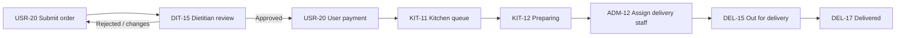

# F.I.L. Foods meal service — module map

This is the cross-module index for the User 5 specification set. Each module has a story index under `docs/specs/`, a verbatim export under `docs/specs/canonical/`, a generated handoff under `.github/`, an optional PDF, and traceability in `docs/implementation-traceability.md` (User) or `docs/implementation-traceability-staff.md` (staff roles). Refresh exports with `scripts/split_canonical_paste.py` and `scripts/sync_module_handoffs_from_canonical.py` (see [`canonical/README.md`](./canonical/README.md)).

## Modules

| Module | Stories | Index | PDF | Handoff | Traceability |
|---|---|---|---|---|---|
| User (client app) | USR-01–USR-50 | [`user-module.md`](./user-module.md) | [`FIL_Foods_User_Module.pdf`](./FIL_Foods_User_Module.pdf) | [`.github/Meal_Service_User_Stories_AI_Agent_Handoff.md`](../.github/Meal_Service_User_Stories_AI_Agent_Handoff.md) | [`implementation-traceability.md`](../implementation-traceability.md) |
| Admin | ADM-01–ADM-21 | [`admin-module.md`](./admin-module.md) | [`FIL_Foods_Admin_Module.pdf`](./FIL_Foods_Admin_Module.pdf) | [`.github/Meal_Service_Admin_Module_AI_Agent_Handoff.md`](../.github/Meal_Service_Admin_Module_AI_Agent_Handoff.md) | [`implementation-traceability-staff.md`](../implementation-traceability-staff.md) |
| Dietitian | DIT-01–DIT-17 | [`dietitian-module.md`](./dietitian-module.md) | [`FIL_Foods_Dietitian_Module.pdf`](./FIL_Foods_Dietitian_Module.pdf) | [`.github/Meal_Service_Dietitian_Module_AI_Agent_Handoff.md`](../.github/Meal_Service_Dietitian_Module_AI_Agent_Handoff.md) | [`implementation-traceability-staff.md`](../implementation-traceability-staff.md) |
| Kitchen | KIT-01–KIT-15 | [`kitchen-module.md`](./kitchen-module.md) | [`FIL_Foods_Kitchen_Module.pdf`](./FIL_Foods_Kitchen_Module.pdf) | [`.github/Meal_Service_Kitchen_Module_AI_Agent_Handoff.md`](../.github/Meal_Service_Kitchen_Module_AI_Agent_Handoff.md) | [`implementation-traceability-staff.md`](../implementation-traceability-staff.md) |
| Delivery | DEL-01–DEL-17 | [`delivery-module.md`](./delivery-module.md) | [`FIL_Foods_Delivery_Module.pdf`](./FIL_Foods_Delivery_Module.pdf) | [`.github/Meal_Service_Delivery_Module_AI_Agent_Handoff.md`](../.github/Meal_Service_Delivery_Module_AI_Agent_Handoff.md) | [`implementation-traceability-staff.md`](../implementation-traceability-staff.md) |

## Shared staff entry

All staff modules assume the same **Select Your Role** entry (ADM-01, DIT-01, KIT-01, DEL-01) with four role cards: Admin, Dietitian, Kitchen Staff, and Delivery Staff. Each role then uses its own login surface and bottom navigation as specified in that module's PDF.

## Order lifecycle (delivery)

## Order lifecycle (pickup)

After Dietitian approval and payment, Kitchen moves the order through preparation (KIT-12, KIT-13 **Ready for Pickup**). The User collects the meal; Kitchen marks completion per KIT-13/KIT-14 scenarios. Admin may still monitor the order on ADM-11/ADM-12 without assignment to Delivery Staff.

## Data ownership

| Data | Primary owner module | Consumed by |
|---|---|---|
| Menu items, prices, availability | Admin (ADM-17, ADM-18) | User browse (USR-16, USR-17), Dietitian read-only menu (DIT-14), Kitchen menu view (KIT-15) |
| Customer profile & meal recipient health/diet | User (USR-07–USR-15, USR-43–USR-46) | Admin customer list (ADM-19), Dietitian review (DIT-11–DIT-15, DIT-17) |
| Staff accounts & roles | Admin (ADM-13–ADM-16) | All staff logins; Dietitian excluded from staff CRUD (DIT-16) |
| Order status & history | Shared contract | User tracking (USR-21–USR-24); Admin (ADM-11, ADM-12); Dietitian (DIT-15); Kitchen (KIT-11–KIT-13); Delivery (DEL-11–DEL-17) |
| Audit log | Admin view (ADM-20); User profile history (USR-38, USR-42) | Security stories across modules |
| Notifications | Admin settings (ADM-21); User inbox (USR-25) | Staff bells (ADM-05, DIT-05, KIT-05, DEL-05) |

## Known implementation gaps (repository snapshot)

These are planning notes, not new requirements. See staff traceability for story-level status.

- The in-app staff console under `frontend/src/admin` uses a **local** store and simplified statuses (Pending, Preparing, Delivered, Cancelled) that do not yet match the PDF order workflow (Dietitian review, payment, assignment).
- Supabase roles today: `client`, `owner_admin`, `kitchen_staff`, `delivery_staff` — **no `dietitian` role** in migrations; DIT stories are blocked until schema and RLS catch up.
- User app Supabase orders and staff mock orders are **not** the same data path until integration work lands.

## Traceability rules

- Mark a story **complete** only when every numbered acceptance criterion in the PDF maps to a passing automated test or a documented manual check.
- When a User story names Admin/Dietitian/Kitchen/Delivery behavior, implement the staff story (or record the conflict) before claiming the User criterion satisfied.
- Spreadsheet Passed / Failed / Total rows in the PDF exports are QA status only, not product features.
